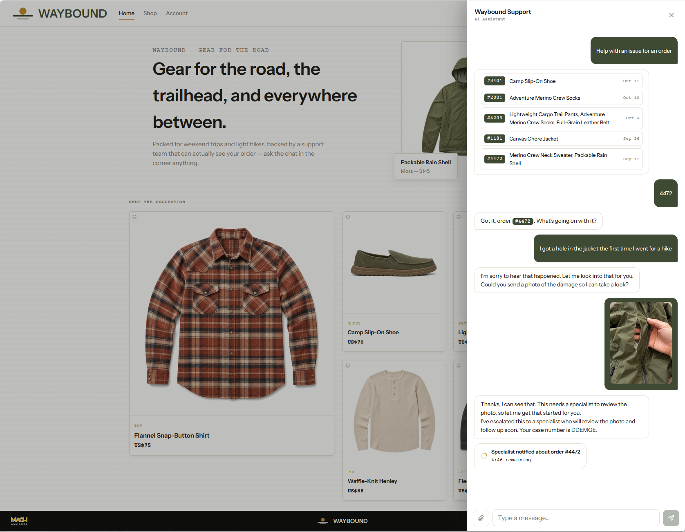
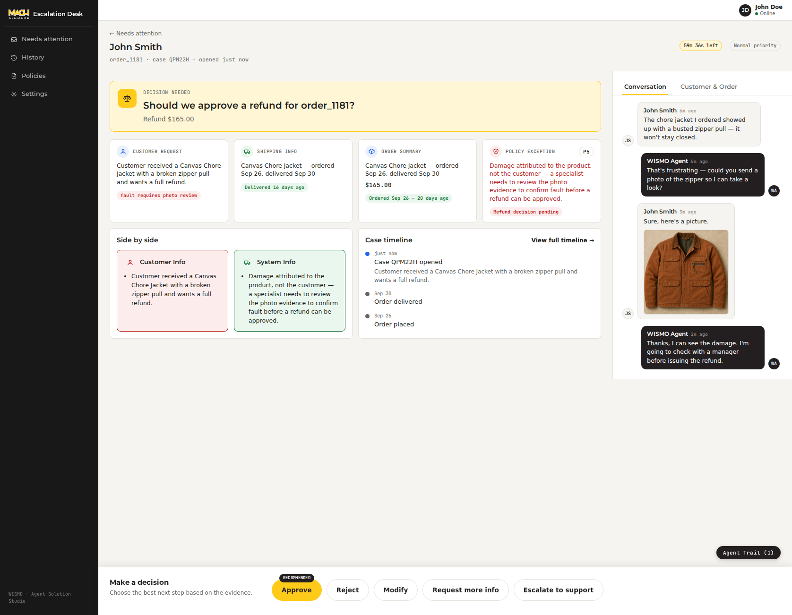
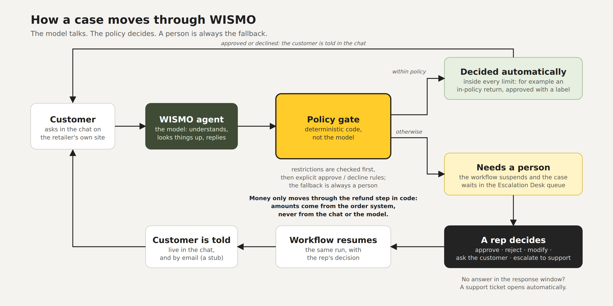

# WISMO



A post-purchase support agent prototype for the **MACH Alliance Agent Solution Studio**.

WISMO is a Tier-1 support agent that lives on a retailer's own site. It answers *where is my order*, handles returns and exchanges, and deals with damage and delivery disputes. It resolves what it can safely resolve on its own, and hands everything else to a person through a real human-in-the-loop queue — the **Escalation Desk** — instead of guessing at an outcome or leaving the customer with an empty promise.

The interesting engineering isn't the chat. It's the **autonomy gate**: exactly which decisions the agent may make alone, and which it must hand to a person. The model handles the conversation; deterministic code decides anything that moves money. The queue is built directly on [Mastra](https://mastra.ai)'s workflow suspend/resume — there is no separate queue database.

The storefront (`Waybound`, a fictional outdoor-gear retailer) is deliberately retailer-branded, not MACH Alliance-branded — it's simulating someone else's site. The Escalation Desk, the rep-facing tool, carries the MACH Alliance logo.

---

## Quick start

You need an [Anthropic](https://console.anthropic.com) API key. Nothing else is required to see it working end to end. (An OpenAI key is optional and only used to regenerate the demo's "damage photos".) Copying `.env.example` also gives you placeholder names for the demo customer and the support rep — the agent requires them, and you can change them to anything.

```bash
git clone <this-repo>
cd wismo
cp .env.example .env
```

Open `.env` and set:

```env
ANTHROPIC_API_KEY=sk-ant-...
```

> **There is no login, so keep the ports private.** The agent, the Escalation Desk and the storefront answer anyone who can reach their ports, and the Policies page in the Desk can change how cases are decided. Both ways of starting the apps listen on every network interface of the machine (Docker publishes the ports on every interface too), so on a server, a VPS or a shared network anyone who can reach those ports can use the apps and spend your API key. Run it on your own machine, or limit the ports to your own address with a firewall rule or an SSH tunnel.

Then pick whichever of these you already have — same app, same `.env`, either way:

**Have Docker?**

```bash
docker compose up --build
```

**Don't have Docker, have Node.js 22+ on Linux, macOS or WSL?**

```bash
npm install
npm run dev     # starts all three; Ctrl-C stops all three
# agent API http://localhost:3006 · Escalation Desk http://localhost:3005 · storefront http://localhost:3007
```

(Each service can also be started on its own — see the setup guide. The dev servers hot-reload on code changes. The Docker path is a self-contained image: rebuild it with `docker compose up --build` after a code change. On native Windows, use Docker — the Next.js scripts use POSIX shell syntax.)

Then open the **storefront** at `http://localhost:3007` and click the chat button, and the **Escalation Desk** at `http://localhost:3005` in another tab. To start from a known set of demo cases, use **Settings → Reset demo data** in the Desk.

> **A real model answers every chat message, so chatting costs money.** A typical conversation is roughly \$0.15 for a simple tracking question and about \$0.40 for a damage claim with a photo (estimates from development testing with prompt caching on, as shipped; without it, about \$0.40 and \$1.20. Not a quote — check your provider's current pricing; see [`docs/production-considerations.md`](docs/production-considerations.md)). The Desk pages themselves make no model calls.

For the full setup guide — every environment variable, the demo walkthrough, running the tests, and troubleshooting — see [`docs/setup-instructions.md`](docs/setup-instructions.md).

---

## What you can try

- **Ask where an order is.** The agent looks up the order and the carrier record and answers from those — it never states a status from memory.
- **Return something you don't want.** Pick which items on a multi-item order; within the policy's window and refund ceilings it is approved on the spot and you're handed a return label.
- **Report a damaged item with a photo.** Damage that isn't the customer's fault always needs a person to look at the photo, so it lands in the Escalation Desk with a live countdown in the customer's chat. (Under the shipped policy, damage the customer says they caused themselves is declined automatically, unless the account is VIP.)
- **Dispute a delivery.** A carrier record that says "delivered" against a customer who says "never arrived" is a person's call, and is flagged high priority.
- **Act as the rep.** In the Desk, review the case and the photo, then approve, reject, change the amount (and tell the customer why), ask the customer a question, or escalate to support. The customer's open chat updates live.
- **Change the rules.** The **Policies** page shows the decision policy in plain English. Describe a change to the Policy Helper, review what it proposes, and save — the new version decides cases immediately, and any earlier version can be restored.
- **Open it on a phone.** Both front ends are responsive, so the storefront chat and the Escalation Desk are mobile friendly. (To try it from another device on your network, set `DEV_LAN_HOST` — see the [setup guide](docs/setup-instructions.md).)

---

## How it works

```
storefront (:3007)                          escalation desk (:3005)
customer chat widget                        the rep's console
      |                                           |
      |  chat (AI SDK UI stream)                  |  queue, case review, policies
      |  live updates (SSE)                       |  decisions
      v                                           v
  +----------------------------------------------------------------------+
  | agent API (:3006) - Hono + Mastra                                    |
  |                                                                      |
  | chat agent (Claude) --- tools ---> orders, shipping, refunds         |
  |       |                                                              |
  |       +-- escalates --> review workflow --- suspends --> the queue   |
  |                              ^                                       |
  |                              +-- a rep's decision resumes it         |
  |                                                                      |
  | policy document ---> evaluated by code, never by the model           |
  +----------------------------------------------------------------------+

  the queue is the review workflow's own runs: there is no separate queue database
  one SQLite (LibSQL) file: workflow runs, traces, policy history
```

- **One decision gate, in code.** Whether a request may be settled automatically is decided by a versioned *policy document* that deterministic code evaluates. Restrictions are checked first — any one of them sends the case to a person — and only then are explicit approval or decline rules considered. The fallback is always a person. The model never decides money, and the amount comes from the order system, not from anything the customer or the model says.
- **The queue is the workflow.** An escalation starts a Mastra workflow that *suspends*. The Escalation Desk lists the suspended runs, and a rep's decision *resumes* the same run. A case that nobody answers within the response window is ticketed automatically.
- **Rep decisions reach the customer.** An open chat is updated live; the customer also gets an email (a stub in this prototype).
- **The policy is data you can edit.** It is a JSON document with settings, facts and rules; the Policies page renders it as plain English, validates every change, and keeps every version.

---

## Architecture

### A case, start to finish



1. **The customer chats.** The widget posts each turn to `POST /chat/wismoAgent` with a per-tab `sessionId` and a per-thread `conversationId`; the server takes only the newest message from the request and keeps the rest of the conversation itself. The chat agent (Claude) looks things up through tools. Who the customer is comes from the server-side session, never from anything the model passes in, and every order, amount and carrier fact comes from the order system.
2. **A refund, return or dispute opens a case.** A case is one run of the review workflow, and its short case ID is the run's own ID. The workflow's single step asks the live policy what may happen. If the policy allows an automatic decision, the step carries it out (approving through `issueRefund`, the one function that moves money, or declining) and the case is resolved on the spot. Otherwise the step **suspends**.
3. **A suspended run is a queue entry.** `GET /escalations` lists them and the Desk polls it every 10 seconds. There is no separate queue table.
4. **A rep decides.** Approve, reject, modify, request more info, or escalate to support, sent to `POST /escalations/:runId/resume`; the same step runs again with the decision. Only "request more info" suspends again: it waits for the customer, and their reply is picked up at the end of their next chat turn (`tools/case-sync.ts`), which restarts the countdown. If the customer's chat tab is not connected there is nobody to wait for, so a support ticket opens instead and the case ends, with the rep's question kept on the record; the Desk tells the rep this before they submit.
5. **Nobody answers in time.** The Desk calls `POST /escalations/check-timeouts` every 30 seconds. A case past the response window with no rep decision gets a (stub) support ticket and is resolved. A case waiting on the customer's answer to a rep's question is swept the same way, with the window counted from when the question was sent.
6. **The customer finds out.** A rep's decision, a follow-up question or a timeout is pushed over SSE to the exact tab that opened the case and also emailed (a stub), so it still reaches them if the tab is closed. A plain return a rep approves carries its label. The case stays in History with the conversation as it stood when it resolved.

### Where things live

All under `apps/agent/src/mastra/`:

| Path | What it does |
|---|---|
| `agents/wismo-agent.ts` | the chat agent: its instructions (which carry the prompt-cache marker), its tools, and the checks on its replies |
| `agents/policy-helper.ts`, `policy/helper.ts` | the Policy Helper, a second agent with no tools that only proposes policy edits and is never reachable from chat |
| `tools/` | what the chat agent can do: look up orders and shipments (`commerce.ts`, `shipping.ts`), refund (`payment.ts`, where `issueRefund` is the only place money moves), check or look up cases, and show the item picker and the offer cards |
| `refund-policy-gate.ts`, `tools/delivery-dispute.ts` | open a case for a refund, return or delivery dispute, after the duplicate checks |
| `workflows/policy-review-workflow.ts` | the one workflow; its suspend and resume is the queue |
| `policy/` | the policy engine: `schema`, `catalog` (what a policy may reference), `context` (the trusted facts), `evaluate`, `validate`, `repository` (versions), `live-policy` (the one entry point live cases use), `base-draft` (the shipped policy), `synopsis` (plain English) |
| `refund-ledger.ts` | what has already been approved, or is still pending, on an order, read from the stored workflow runs rather than a second copy |
| `system-authority.ts` | the spending ceiling that sits outside the policy |
| `case-events.ts`, `notifications.ts` | the live push (an in-process emitter feeding SSE) and the stubbed email |
| `response-leak-guard.ts`, `case-id-guard.ts`, `claim-grounding-guard.ts`, `customer-statements.ts` | checks on what the agent says (see the rules below) |
| `conversation-threads.ts`, `chat-input.ts` | the server's own copy of each conversation (one row per chat in the same database as the workflow runs), and the cleaning of the one new customer message a request may add to it |
| `request-context.ts` | the session, conversation and customer a request runs under |
| `demo-seed.ts`, `runtime-settings.ts` | the demo scenarios, and the settings that change at run time (held in memory) |

### Rules the design depends on

- **The model talks; code decides.** Ownership, amounts and eligibility are checked in code against the order system. No tool takes a customer ID as input, and a customer's item selection is resolved against the order's real line items, so an amount is never taken from the conversation.
- **Restrictions first, a person last.** Any matching policy restriction sends the case to a person, wherever it sits in the list. An automatic decision needs an explicit approval or decline rule, the fallback is always a person, and an error while evaluating is a person, never an approval.
- **Money is re-checked as it moves.** `issueRefund` asks the policy again, reads the other open cases on the order itself, and holds a per-order lock, so a case opened a moment earlier cannot be missed. A rep's approval is the human decision and is not re-checked. Separately, `WISMO_MAX_AUTONOMOUS_AMOUNT` is a ceiling no policy edit can raise (0 stops automatic approvals altogether).
- **"Approved", never "issued".** The app only ever knows a refund was approved; paying it is the order system's job, so no screen or message says it was paid.
- **One case per thing.** An item with an open case, an approved refund or a support ticket cannot be claimed again, from the same chat or another one; the customer is told where it stands. A delivery dispute that was already decided, approved or rejected, is not opened again either: the customer is told the outcome and offered escalation to support.
- **The server holds the conversation.** The model is only ever given the thread the server stored, never the browser's copy. Each request supplies one new customer message, which is cleaned (customer role only, text and photos only, length-capped, invisible characters removed, a photo's type read from its bytes), and the model's own replies, its tool calls and results, and the notices pushed to the chat are written to the thread by the server, in the order the customer sees them (a notice that arrives while an answer is being written follows it). A customer who edits their browser's request cannot add a system instruction, a made-up agent reply or tool result, or change the agent's settings, and a thread belongs to the session that started it and to the trusted customer. "Try again" removes the failed reply but keeps what that turn already did, so a refund or case it recorded is not forgotten and attempted again. A case's transcript is cut at the conversation's stored list, so a second case in the same chat starts at its own opening message. What a customer really types is still the customer's own words, and plain-English instructions inside it are covered by the rule above: money, ownership and policy are decided in code, not by how the model reads a message.
- **The agent is handed the facts, and its specifics are checked.** Statuses reach the model as ready-made sentences. A reply's amounts, timeframes, dates and ticket or case IDs must appear in a tool result or in the customer's own words, internal reason codes are blocked, and a customer is told in general terms why a case escalated, never the threshold.
- **A decision can always be taken further.** A customer who disagrees with a decided case, whether the agent decided it by policy or a rep did, can be offered a card that escalates it to a support ticket, and the customer confirms it before anything is created. That path never reads `policy.json`, so no policy edit can switch it off. Whether the agent offers the card at the right moment is the model's judgment, not a code rule.
- **The prompt stays the same, so it can be cached.** The agent's instructions and tool list are identical on every model call and carry a cache marker, which is what keeps model cost down (about two thirds less on a typical conversation). Anything specific to one customer goes in a separate block after it, never inside it.
- **A push goes to one tab.** Live updates carry the `sessionId` of the tab that opened the case. The chat thread has its own `conversationId`, so starting a new chat keeps the live connection.
- **One process.** The event emitter and the run-time settings live in memory, so the agent runs as exactly one process.

### HTTP API

Every route is in `apps/agent/src/server.ts`, served on `:3006`.

| Route | What it does |
|---|---|
| **Customer chat** | |
| `POST /chat/:agentId` | one chat turn, streamed as AI SDK UI messages; the body needs `sessionId` and a `messages` list whose last entry is the new customer message (earlier entries are ignored), `conversationId` is optional, and `trigger: "regenerate-message"` reruns the last customer message (the widget's Try again); answers `400` for a message it cannot accept, `403 conversation_not_yours` for another session's conversation, `409 conversation_too_long` past 200 messages, and `429 turn_in_progress` if that session's previous turn is still running |
| `GET /chat/:agentId/events?sessionId=` | server-sent events for one tab: case resolved, more info requested, countdown started; resumes from `Last-Event-ID` |
| `POST /chat/:agentId/escalate-disagreement` | after the customer confirms the card, opens a (stub) support ticket for a resolved case they disagree with; repeating it returns the same ticket |
| `GET /me` | the demo customer and their orders |
| `GET /products` | the product records behind the seeded orders |
| `GET /tracking/:trackingNumber`, `GET /returns/:trackingNumber` | the data behind the tracking page and the return-label page; the number itself is the access |
| **Cases (the Escalation Desk)** | |
| `GET /escalations` | open cases, already ordered (not yet ticketed first, then priority, then newest); no transcripts |
| `GET /escalations/history` | resolved cases |
| `GET /escalations/:runId` | one case, open or resolved, with its transcript |
| `GET /escalations/:runId/trace` | the agent's trail for the case: tool calls from the chat turns and the workflow's own spans |
| `POST /escalations/:runId/resume` | a rep's decision: `approve`, `reject`, `modify`, `request_more_info` or `escalate_to_support` |
| `POST /escalations/check-timeouts` | the response-window sweep; a cron job can call it instead of the Desk |
| **Policy** | |
| `GET /policy/:namespace` | the live policy, its versions, the catalog and a plain-English synopsis |
| `POST /policy/:namespace/helper` | the Policy Helper proposes an edit to the live policy; nothing is saved |
| `POST /policy/:namespace/validate` | checks a document without saving it |
| `POST /policy/:namespace/activate` | validates, then saves as the new live version; `400` with the issues if it is invalid |
| `POST /policy/:namespace/rollback` | makes an earlier version live again as a new version, so history is kept |
| **Settings and housekeeping** | |
| `GET /settings`, `POST /settings` | the response windows, the queue priority threshold and the spending ceiling; reset on restart |
| `GET /rep` | the signed-in rep's name, from `.env` |
| `POST /demo/reset` | clears every case, stored chat conversation and disagreement ticket, and reseeds the demo scenarios |
| `GET /health` | liveness, used by the Docker health check |

The Desk always uses the `demo` policy namespace, and `demo`'s live version decides every real case. Any other namespace name is an isolated sandbox that live cases never read.

---

## Stack

| Layer | Technology |
|---|---|
| Agent framework | [Mastra](https://mastra.ai) (`@mastra/core` 1.x) — agent, tools, one workflow |
| Backend | [Hono](https://hono.dev) on Node.js |
| Storage | LibSQL (a SQLite file) — workflow runs, traces, policy versions; no separate queue database |
| Chat protocol | [Vercel AI SDK](https://sdk.vercel.ai) v7 UI-message stream |
| LLM | Claude (Anthropic) — default `anthropic/claude-sonnet-4-5`, overridable with `WISMO_CHAT_MODEL` |
| Storefront and Desk | Next.js 16 (App Router) + React 19 + TypeScript — two independent apps |
| Chat widget | [assistant-ui](https://www.assistant-ui.com) (`@assistant-ui/react`) |
| Live push | Server-sent events from an in-process emitter |
| Demo photos | OpenAI `gpt-image-1`, once at seed time, optional |
| Packaging | Plain Node (npm workspaces) or a self-contained Docker image — neither is a hard dependency |

Orders, customers, carrier records, payments and notifications run against local fixtures behind the same interfaces a live system would use, so nothing outside the model provider needs an account to try it.

---

## Project structure

```
wismo/
  apps/
    agent/              # Hono + Mastra backend (:3006)
      src/
        mastra/         #   the agent, its tools, the review workflow, and the policy engine (policy/)
        fixtures/       #   demo customers, orders, products, and carrier records
        server.ts       #   every HTTP route (listed under Architecture above)
      data/             #   catalog fixtures, demo damage photos, and the policy history
      tests/            #   unit and integration tests, mirroring src/
    escalation-desk/    # Next.js — the rep's console (:3005)
    storefront/         # Next.js — the Waybound retailer site and chat widget (:3007)
  shared/               # code the apps share: the policy JSON parser, and the wording of the chat's case notices
  scripts/              # run-all.mjs: starts and stops the three apps together (npm run dev, npm start)
  docs/                 # setup, implementation guide, production considerations, business case
  Dockerfile, docker-compose.yml, .dockerignore   # the optional container path — see Quick start
```

Run every test with `npm test` from the repo root (none of them call a model): the policy engine (including a check that it decides 18,320 generated requests the same way the engine it replaced did), the money step, the demo seed, the chat's error and photo handling, that the model is only ever given the server's own thread (a forged history, forged agent settings or another session's or customer's conversation in a request change nothing), that a retry after a tool already ran does not run it again, that a second case in one chat starts at its own message, that a lookup which fails after the agent's opening line is still answered, that a rep's notice is stored in the order the customer sees it, that Try again after a dropped send sends the new message, a model that obeys every instruction a hostile customer gives (it still cannot refund the wrong thing, reach another customer's data or show a made-up fact), odd and oversized requests, conversations under load and failure, generated inputs for the message cleaner and the retry history, that the prompt carries its cache marker on every model call, the reply guard that keeps internal reason codes away from customers (including a code from a rule added to the policy later), the automatic paths an edited policy can open (disputes decided by rule, a damage claim approved by rule, the spending ceiling clamping it), a customer disagreeing with an automatic decision, and the Desk's policy-diff logic.

The demo data — customers, orders and products — is fictional. The product photos are AI-generated.

---

## Documentation

- **[`docs/setup-instructions.md`](docs/setup-instructions.md)** — the full setup guide: every environment variable, the demo walkthrough, tests, Docker details and troubleshooting.
- **[`docs/production-considerations.md`](docs/production-considerations.md)** — what the prototype does and does not address: model cost, the judgments the agent makes, the container image, and the gaps a real deployment would close.
- **[`docs/implementation-guide.md`](docs/implementation-guide.md)** — the sequenced backlog that closes those gaps, written for the engineers doing the work.
- **[`docs/business-case-template.md`](docs/business-case-template.md)** — the savings opportunity: how to estimate the share of human chat time WISMO could save, which figures are published and which still have to be measured.

---

## Scope

Explicitly out of scope for this prototype:

- Cart or checkout — the storefront is browse and support only
- A real ticketing system — escalated and timed-out cases open a stubbed ticket (logged, with a fake id) and customer notifications are a stubbed email
- A message bus — live updates come from an in-process emitter, so the agent must run as exactly one process
- Persisted runtime settings — the response windows and the spending ceiling reset on restart (the decision policy itself *is* persisted and versioned)
- Authentication and TLS — the Escalation Desk has no login (a single configured rep name, shown in the header), and its Policies page can change how cases are decided; **do not expose these ports to an untrusted network**
- Limits on what a customer can send — the chat accepts a request, a photo or a conversation of any size and any number of messages (apart from one running turn per session and a cap of 200 messages per conversation); **do not expose the chat to an untrusted network** without the limits in the implementation guide
- Legal and privacy review — nothing here has been checked against any country's laws (telling customers they are talking to an AI, automatic declines, personal data, retention); it is a starting point, not legal advice, so check the rules where you operate
- Validating order data — the order, carrier and customer records are trusted as given
- A sandbox for trying a policy against sample requests
- Native mobile apps — both front ends are responsive web
- Multi-process or horizontally scaled deployment

See [`docs/production-considerations.md`](docs/production-considerations.md) for what each of these means for a real deployment, and [`docs/implementation-guide.md`](docs/implementation-guide.md) for how to close them.
